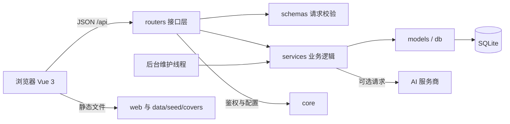
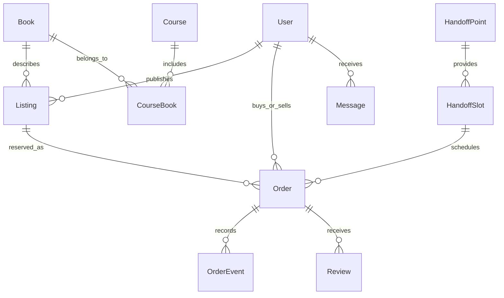
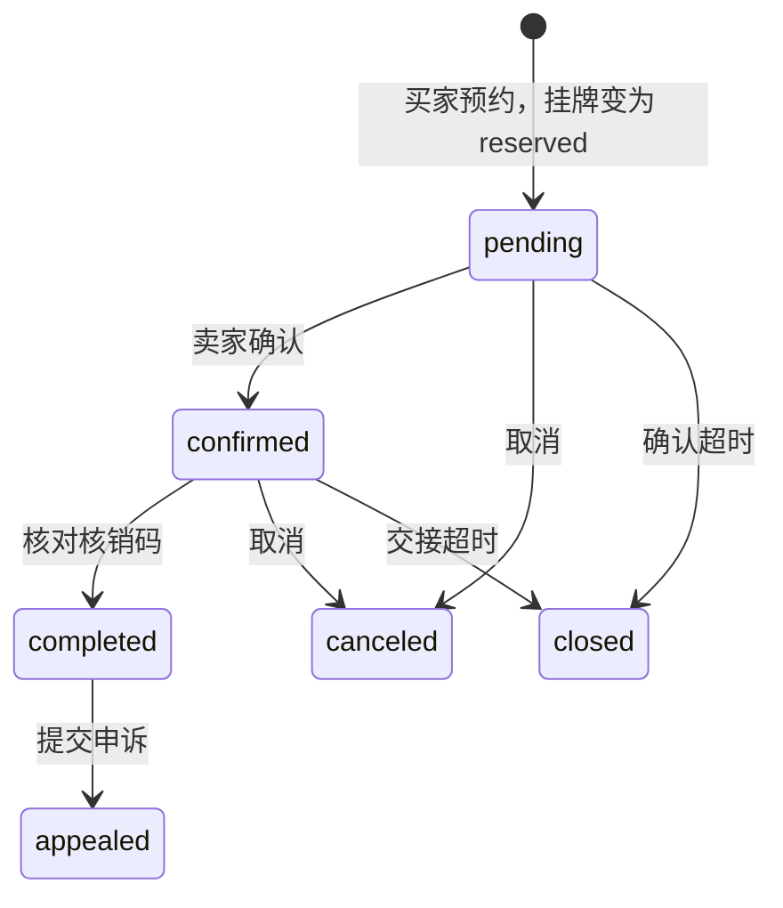

# 工程结构与答辩讲解

## 系统如何运行

书循是一个前后端职责分离、同一进程部署的课程项目。浏览器加载本地 Vue 3 运行时和页面脚本；FastAPI 同时提供 API、图片和网页。默认 SQLite 模式不需要安装独立数据库服务。

1. `run.py` 读取配置并调用 Uvicorn；开发模式只监控 `src/` 的变更。
2. `src/main.py` 注册统一异常处理、路由与静态文件，启动时建表、补旧库字段、启动维护线程。
3. `src/core/config.py` 读取环境变量与 `configs/.env`，统一决定数据目录与服务参数。
4. `src/db.py` 给每个 API 请求提供独立数据库会话，请求结束后关闭；修改操作由业务入口提交事务。
5. `web/index.html` 按依赖顺序加载脚本，最后由 `web/js/start.js` 注册组件和指令、挂载 Vue。

## 代码阅读顺序

| 想解释的内容 | 从哪里开始 | 关键点 |
| --- | --- | --- |
| 页面与后端如何通信 | `web/js/core.js` | `apiRequest` 统一发送 JSON、附带 Bearer 令牌并处理错误 |
| 页面切换 | `web/js/app.js`、`core.js` | Hash 路由切换组件；受保护页面跳转登录 |
| 登录权限 | `src/routers/auth.py`、`core/deps.py` | bcrypt 校验密码、JWT 签发、角色依赖 |
| 输入校验 | `src/schemas.py` | Pydantic 校验长度、类型、范围，再进入路由 |
| 目录与在架书的区别 | `src/models.py`、`services/catalog.py` | `Book` 是教材元数据，`Listing` 是某位卖家的具体挂牌 |
| 搜索 | `src/routers/search.py` | SQL 条件组合；批量读取关联对象减少重复查询 |
| 订单流转 | `src/routers/orders.py` | 下单锁定、卖方确认、核销完成、取消及申诉 |
| 信用分与超时 | `services/credit.py`、`maintenance.py` | 分数变化记录；定期释放过期预约和处理暂存 |
| AI 推荐 | `services/assistant.py` | 后端把公开书目和平台规则作为上下文，返回可点击的真实教材 |
| 演示数据 | `scripts/init_data.py`、`data/seed/demo.json` | 按外键顺序初始化；业务数据与初始化逻辑分离 |

## 数据关系

课程与教材通过 `CourseBook` 实现多对多；一本教材可以有多个卖家的挂牌。订单保存成交价格快照、买卖双方和交接安排，订单事件保存过程记录。取消订单可让同一挂牌再次被预约，因此挂牌与历史订单是一对多。

## 一笔交易如何完成

模型还保留 `pending_handoff`（待交接）状态，核销和超时逻辑兼容它；当前正常演示路径是 `pending → confirmed → completed`。核销时挂牌变成 `sold`，更新双方信用分并生成通知；随后买卖双方可评价。实际验书和付款在线下进行，没有在线支付网关。

## 为什么这样组织

- `routers` 处理 HTTP 输入、权限和响应；`services` 放可复用业务，例如后台与 CLI 共用同一个 Excel 导入服务。
- `models` 定义持久化表，`schemas` 定义请求数据；两者不混用，便于解释输入校验与数据存储的差别。
- `services/batch.py` 一次获取一组主键的关联数据；列表循环查字典，避免每张卡片单独查库。
- 前端直接使用 Vue 运行时模板，便于课程阅读和单机演示，没有 Node 构建或 npm 安装步骤。
- 动效集中在 `web/js/motion.js`，共享组件集中在 `components.js`，页面业务放在 `pages/`。
- 数据库里的 `sys_params` 可由后台修改；`core/config.py` 中的阈值仅提供默认值。

## 当前实现边界

这是单进程课程演示系统。默认短信验证码只在日志输出，登录保留演示验证码 `888888`；微信未配置时可模拟登录。邮件发送、病毒扫描和敏感内容检测尚未接入。AI 需要外部服务密钥；没有密钥时界面显示不可用状态。

内存限流、参数缓存和定时线程按进程工作，多实例部署需要重新设计共享状态和调度。自动检查覆盖 SQLite 与本地文件存储；MySQL、Redis、S3/MinIO 接口保留，但不代表已完成真实服务集成验收。默认开发密钥、宽松 CORS 和模拟登录也需要在公网部署前调整。

答辩时应把已实现流程、模拟服务和未来工作分开说明，不把接口预留当成已落地能力。
